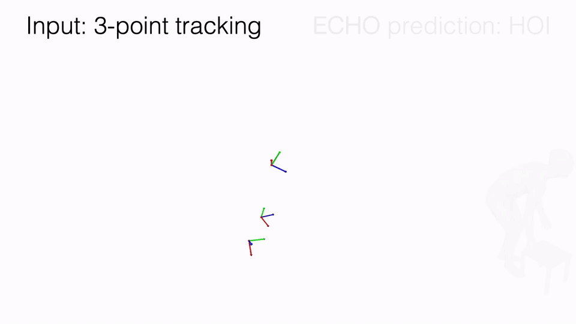

<!-- HEADER -->
<p align="center">
    <h1 align="center">ECHO: Ego-Centric modeling of Human-Object interactions</h1>
    <!-- authors -->
    <p align="center">
        <a href="https://ptrvilya.github.io/"><b>Ilya A. Petrov</b></a>
        &emsp;
        <a href="https://vguzov.github.io/"><b>Vladimir Guzov</b></a>
        &emsp;
        <a href="https://ricma.netlify.app/"><b>Riccardo Marin</b></a>
        &emsp;
        <a href="https://emreaksan.github.io/"><b>Emre Aksan</b></a>
        <br>
        <a href="https://xuchen-ethz.github.io/"><b>Xu Chen</b></a>
        &emsp;
        <a href="https://cvg.cit.tum.de/members/cremers"><b>Daniel Cremers</b></a>
        &emsp;
        <a href="https://thabobeeler.com/"><b>Thabo Beeler</b></a>
        &emsp;
        <a href="https://virtualhumans.mpi-inf.mpg.de/people/pons-moll.html"><b>Gerard Pons-Moll</b></a>
    </p>
    <!-- conference -->
    <h3 align="center">ECCV 2026</h3>
    <!-- teaser -->
    <p align="center">
        
    </p>
    <!-- badges -->
    <p align="center">
        <a href="https://arxiv.org/abs/2508.21556">
            
        </a>
        &emsp;
        <a href="https://ptrvilya.github.io/echo/">
            
        </a>
        &emsp;
        <a href="https://youtu.be/GYFqW6y36D0">
            
        </a>
    </p>
</p>

ECHO recovers human pose, object motion, and contact dynamics solely from head and wrist tracking.
It models the interaction with a tri-variate diffusion process over human, object, and contact,
and generates temporally consistent interactions for arbitrarily long sequences.


## Environment
The code was tested under `Ubuntu 24.04, Python 3.10, CUDA 12.8, PyTorch 2.9.1`.
Use the following commands to create a conda environment with the necessary dependencies and install
this repository as an editable package (required for imports to resolve):
```bash
conda env create -f environment.yml
conda activate echo
pip install -e .
```
All paths (datasets, assets, experiments, body models) are set in [scenarios/env.yaml](./scenarios/env.yaml);
update it before running anything. Every entry point takes config files with `-c` and OmegaConf overrides after `--`:
```bash
python main.py -c scenarios/env.yaml scenarios/<scenario>.yaml -- key=value ...
```

## Data downloading and processing
The steps are described in [docs/data.md](./docs/data.md).


## Pre-trained models and evaluation
Pre-trained model: [link](https://drive.google.com/file/d/129CLzZQ2MLegK3-b4RxtZKPalrnLrUus/view?usp=sharing).
Place the checkpoint under `./assets/` and pass the path via `resume.checkpoint`.

The command below runs sampling on the test splits. Parameter `sample.modalities` controls which modalities are
generated and which are given as input, i.e. three digits correspond to human, object, and contacts, respectively;
`1` means the modality is sampled, `0` means it is conditioned on. Head and wrist tracking is always provided.
For example, `sample.modalities="'111'"` generates everything from tracking only,
`sample.modalities="'011'"` generates object motion and contacts given the human motion.
```bash
python main.py -c scenarios/env.yaml scenarios/echo.yaml -- \
  run.job=sample run.name=001_echo resume.checkpoint="./assets/echo.pth" \
  sample.modalities="'111'" sample.mode=sample_inpaint sample.alpha=0.4 \
  sample.slice_strategy=deterministic_w_overlap sample.overlap_size=30 \
  sample.datasets=['amass','behave','omomo'] sample.repetition_id=[0,1,2] \
  sample.artifacts_folder_suffix=inpaint
```
`sample.mode` selects how sequences longer than the training window are processed:
`sample_naive` (independent windows), `sample_stitch` (overlapping windows blended after denoising),
`sample_inpaint` (previous window inpainted into the overlap; `sample.alpha` controls smoothing).

Samples are stored under `experiments/<run.name>/artifacts_<suffix>/step_<step>_samples/<dataset>_test/<target>/repetition_<i>/`.
Use the command below to evaluate them. The `eval.sampling_target` parameter selects the
sample folders to evaluate (`sbj`, `sbj_obj`, `obj`, with the `_from_contact` suffix when contacts were given):
```bash
python main.py -c scenarios/env.yaml scenarios/echo.yaml -- \
  run.job=eval run.name=001_echo resume.step=-1 \
  sample.datasets=['amass','behave','omomo'] eval.sampling_target=['sbj_obj'] \
  sample.artifacts_folder_suffix=inpaint
```

## Training
Use the following command to run the training (on AMASS, BEHAVE and OMOMO):
```bash
python main.py -c scenarios/env.yaml scenarios/echo.yaml -- \
  run.name=001_echo run.job=train
```
Training resumes automatically from the last checkpoint in `experiments/<run.name>/checkpoints/` when the
same `run.name` is given again.


## Citation
```bibtex
@inproceedings{petrov2026echo,
  title={ECHO: Ego-Centric modeling of Human-Object interactions},
  author={Petrov, Ilya A and Guzov, Vladimir and Marin, Riccardo and Aksan, Emre and Chen, Xu and Cremers, Daniel and Beeler, Thabo and Pons-Moll, Gerard},
  booktitle={European Conference on Computer Vision},
  year={2026},
  organization={Springer}
}
```


## Acknowledgements
This project benefited from the following resources:
* [AMASS](https://amass.is.tue.mpg.de/), [BEHAVE](https://virtualhumans.mpi-inf.mpg.de/behave/license.html),
  and [OMOMO](https://github.com/lijiaman/omomo_release) datasets;
* [smplx](https://github.com/vchoutas/smplx) repository: SMPL-X body model;
* [smplfitter](https://github.com/isarandi/smplfitter): SMPL+H to SMPL-X conversion of BEHAVE;
* [HuMoR](https://github.com/davrempe/humor): AMASS cleanup rules;
* [EgoAllo](https://github.com/brentyi/egoallo) and [BoDiffusion](https://github.com/BCV-Uniandes/BoDiffusion): baselines and HMD conditioning;
* [TriDi](https://github.com/ptrvilya/tridi): three-variate diffusion, object keypoints and PointNeXt features;
* [PointNeXt](https://github.com/guochengqian/PointNeXt): point cloud encoder;
* [diffusers](https://github.com/huggingface/diffusers): base for the DDPM scheduler.
